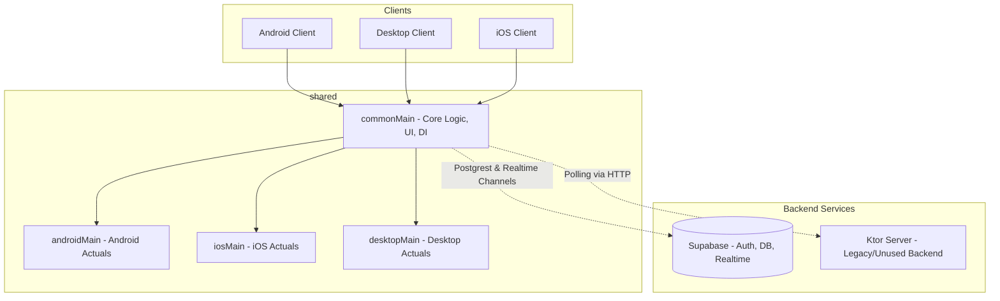

# Signy Tactical Multiplatform Application

Welcome to the **Signy Tactical Multiplatform Application** codebase. This is a Kotlin Multiplatform (KMP) project supporting Android, iOS, and Desktop clients, powered by a Supabase backend for real-time signaling, security asset tracking, and messaging.

---

## 🛠️ Codebase Fixes, Issues & Tasks

This section outlines critical fixes, tasks, and recommendations identified in [codebase_analysis_report.md](file:///Users/manpreet/.gemini/antigravity-ide/brain/5d550fb6-58f3-44a6-a72a-d56e4d5d5247/codebase_analysis_report.md) that must be addressed to ensure proper compilation, database compatibility, and runtime stability.

### 1. KMP Platform Compilation & Dependency Injection Fixes

> [!IMPORTANT]
> The project currently suffers from compilation failures due to platform-specific configuration discrepancies.

* **Android Expect/Actual Constructor Mismatches**: 
  - **Issue**: [ContactsProvider.kt](file:///Users/manpreet/Desktop/AndroidStudioProjects/WebRTC-RTSP-App/shared/src/commonMain/kotlin/com/myapplication/common/data/contacts/ContactsProvider.kt) and [NotificationService.kt](file:///Users/manpreet/Desktop/AndroidStudioProjects/WebRTC-RTSP-App/shared/src/commonMain/kotlin/com/myapplication/common/data/notifications/NotificationService.kt) in `commonMain` declare parameterless constructors. However, their Android actual declarations in [ContactsProvider.kt (Android)](file:///Users/manpreet/Desktop/AndroidStudioProjects/WebRTC-RTSP-App/shared/src/androidMain/kotlin/com/myapplication/common/data/contacts/ContactsProvider.kt) and [NotificationService.kt (Android)](file:///Users/manpreet/Desktop/AndroidStudioProjects/WebRTC-RTSP-App/shared/src/androidMain/kotlin/com/myapplication/common/data/notifications/NotificationService.kt) require an Android `Context` parameter.
  - **Fix**: Introduce a thread-safe global `PlatformContext` holder in the `androidMain` source set. Initialize it during the `onCreate()` callback of [MainApplication.kt](file:///Users/manpreet/Desktop/AndroidStudioProjects/WebRTC-RTSP-App/androidApp/src/androidMain/kotlin/com/myapplication/MainApplication.kt). Update the Android `actual` classes to use this global context instance internally, allowing them to remain parameterless.
* **Missing Desktop Platform Implementations**:
  - **Issue**: The `desktopMain` module compiles targeting the desktop App, but completely lacks `actual` implementations for:
    - `GoogleMapView(modifier: Modifier)`
    - `RTSPPlayer(url: String, modifier: Modifier)`
    - `VideoRenderer(track: VideoStreamTrack?, modifier: Modifier)`
    - `ContactsProvider`
    - `NotificationService`
  - **Fix**: Implement fallback stubs/placeholders in `shared/src/desktopMain` to resolve link errors and support execution on desktop platforms.
* **Desktop DI Koin Startup Crash**:
  - **Issue**: The desktop Gradle target executes the `main` entry point at [main.kt](file:///Users/manpreet/Desktop/AndroidStudioProjects/WebRTC-RTSP-App/desktopApp/src/desktopMain/kotlin/main.kt). This entry point fails to call `initKoin()`, causing immediate crash upon resolving DI-injected services such as `SupabaseService`. A duplicate entry point exists at [main.kt (JVM)](file:///Users/manpreet/Desktop/AndroidStudioProjects/WebRTC-RTSP-App/desktopApp/src/desktopMain/jvmMain/kotlin/main.kt) which does call it, but it is unmapped in Gradle source sets.
  - **Fix**: Remove the duplicate file/directory and add the `initKoin()` call to the active entry point in [main.kt](file:///Users/manpreet/Desktop/AndroidStudioProjects/WebRTC-RTSP-App/desktopApp/src/desktopMain/kotlin/main.kt).

### 2. Database Schema Harmonization (`setup.sql`)

> [!WARNING]
> The database schema defined in `setup.sql` differs substantially from the queries, structures, and model serialization attributes used in the shared source set. Running the current `setup.sql` will cause database query failures.

* **Fix**: Run the corrected schema script below. It updates table structures to match the `@SerialName` annotations inside [Models.kt](file:///Users/manpreet/Desktop/AndroidStudioProjects/WebRTC-RTSP-App/shared/src/commonMain/kotlin/com/myapplication/common/domain/model/Models.kt) and [SupabaseService.kt](file:///Users/manpreet/Desktop/AndroidStudioProjects/WebRTC-RTSP-App/shared/src/commonMain/kotlin/com/myapplication/common/data/supabase/SupabaseService.kt):

```sql
-- Harmonies the schema for KMP-Supabase integration

-- 1. Create Profiles Table (Syncs with Auth users)
CREATE TABLE IF NOT EXISTS public.profiles (
    id UUID PRIMARY KEY,
    full_name TEXT NOT NULL,
    avatar_url TEXT,
    phone_number TEXT
);

-- 2. Create Businesses Table (With snake_case columns and owner relations)
CREATE TABLE IF NOT EXISTS public.businesses (
    id UUID PRIMARY KEY DEFAULT gen_random_uuid(),
    name TEXT NOT NULL,
    latitude DOUBLE PRECISION,
    longitude DOUBLE PRECISION,
    address TEXT,
    category TEXT,
    owner_id UUID REFERENCES public.profiles(id) ON DELETE SET NULL
);

-- 3. Create Cameras Table (With owner/business linkages and status flags)
CREATE TABLE IF NOT EXISTS public.cameras (
    id UUID PRIMARY KEY DEFAULT gen_random_uuid(),
    name TEXT NOT NULL,
    url TEXT NOT NULL,
    status TEXT DEFAULT 'ONLINE',
    business_id UUID REFERENCES public.businesses(id) ON DELETE CASCADE,
    owner_id UUID REFERENCES public.profiles(id) ON DELETE SET NULL
);

-- 4. Create Messages Table (Using unified snake_case attributes)
CREATE TABLE IF NOT EXISTS public.messages (
    id UUID PRIMARY KEY DEFAULT gen_random_uuid(),
    sender_id UUID NOT NULL REFERENCES public.profiles(id) ON DELETE CASCADE,
    receiver_id UUID NOT NULL REFERENCES public.profiles(id) ON DELETE CASCADE,
    text TEXT NOT NULL,
    created_at TIMESTAMPTZ DEFAULT now(),
    type TEXT DEFAULT 'TEXT'
);

-- 5. Create Connection Requests Table (For Contacts & Invites Grid)
CREATE TABLE IF NOT EXISTS public.connection_requests (
    id UUID PRIMARY KEY DEFAULT gen_random_uuid(),
    sender_id UUID NOT NULL REFERENCES public.profiles(id) ON DELETE CASCADE,
    target_email TEXT NOT NULL,
    status TEXT DEFAULT 'PENDING',
    created_at TIMESTAMPTZ DEFAULT now()
);

-- 6. Create Signaling Table (WebRTC Signal Exchange Grid)
CREATE TABLE IF NOT EXISTS public.signaling (
    id UUID PRIMARY KEY DEFAULT gen_random_uuid(),
    call_id TEXT NOT NULL,
    sender_id UUID NOT NULL REFERENCES public.profiles(id) ON DELETE CASCADE,
    type TEXT NOT NULL,
    data TEXT NOT NULL,
    created_at TIMESTAMPTZ DEFAULT now()
);

-- Realtime Publication Registration
ALTER PUBLICATION supabase_realtime ADD TABLE public.messages;
ALTER PUBLICATION supabase_realtime ADD TABLE public.signaling;
```

### 3. WebRTC Calling & Signaling Channel Fixes

> [!CAUTION]
> WebRTC communication will fail because signaling participants subscribe to separate channels, and incoming calls cannot be answered.

* **Signaling Channel Negotiation**: 
  - **Issue**: [ActiveCallScreen.kt](file:///Users/manpreet/Desktop/AndroidStudioProjects/WebRTC-RTSP-App/shared/src/commonMain/kotlin/com/myapplication/common/ui/screens/ActiveCallScreen.kt) currently constructs a room ID using `name.lowercase().filter { it.isLetterOrDigit() } + "_session"`. If User A calls User B, User A connects to B's room, whereas User B connects to A's room. No signaling data is exchanged because they are on different channels.
  - **Fix**: Use a deterministic, mutual channel naming convention by sorting the user IDs of both caller and receiver (e.g. `val callId = listOf(userIdA, userIdB).sorted().joinToString("_") + "_session"`).
* **Incoming Call Reception & Binding**:
  - **Issue**: The method `WebRTCManager.answerCall(...)` exists, but is never invoked. The app does not poll or listen to incoming calls.
  - **Fix**: Create a signaling/call event observer at dashboard load. Upon receiving an `OFFER` signal targeting the user, present an Incoming Call Overlay UI that allows the receiver to accept (calling `answerCall`) or decline the call.

### 4. UI/UX & Legacy Code Removal

* **Unregistered AI Assistant**:
  - **Issue**: The `AssistantTab` is not registered in the bottom navigation items list of [DashboardScreen.kt](file:///Users/manpreet/Desktop/AndroidStudioProjects/WebRTC-RTSP-App/shared/src/commonMain/kotlin/com/myapplication/common/ui/screens/DashboardScreen.kt), meaning users cannot navigate to it. Furthermore, it only yields hardcoded response mockups.
  - **Fix**: Register `AssistantTab` in bottom navigation. Link it to an active Gemini LLM integration utilizing Firebase AI logic or Supabase Edge Functions.
* **Dead Code Cleanup**:
  - **Issue**: [BusinessRepository.kt](file:///Users/manpreet/Desktop/AndroidStudioProjects/WebRTC-RTSP-App/shared/src/commonMain/kotlin/com/myapplication/common/data/repository/BusinessRepository.kt) utilizes Ktor to call local server endpoints (`http://10.0.2.2:8080/api/business`), but is completely unregistered in DI and unused in the UI.
  - **Fix**: Safely remove this file and cleanup legacy server endpoints in [Application.kt](file:///Users/manpreet/Desktop/AndroidStudioProjects/WebRTC-RTSP-App/server/src/main/kotlin/com/myapplication/server/Application.kt) if Supabase is used exclusively.

---

## 🏗️ App Architecture

The system utilizes clean Kotlin Multiplatform layers split across client targets and a standalone server module.



### Module Roles & Interfaces
1. **`shared`**: The central library module containing all core logic.
   - `commonMain`: Shared Composed UI layouts, theme styles, Koin DI declarations, database operations (`SupabaseService`), and webrtc controller (`WebRTCManager`).
   - `androidMain` / `iosMain` / `desktopMain`: Platform-specific code supporting camera rendering (`VideoRenderer`), Maps (`GoogleMapView`), local contacts querying (`ContactsProvider`), and OS notifications (`NotificationService`).
2. **`androidApp`**: Android runner package. Contains [MainActivity.kt](file:///Users/manpreet/Desktop/AndroidStudioProjects/WebRTC-RTSP-App/androidApp/src/androidMain/kotlin/com/myapplication/MainActivity.kt) (deeplink handling and fullscreen display) and [MainApplication.kt](file:///Users/manpreet/Desktop/AndroidStudioProjects/WebRTC-RTSP-App/androidApp/src/androidMain/kotlin/com/myapplication/MainApplication.kt).
3. **`desktopApp`**: Desktop runner package. Contains [main.kt](file:///Users/manpreet/Desktop/AndroidStudioProjects/WebRTC-RTSP-App/desktopApp/src/desktopMain/kotlin/main.kt) that boots Compose for Desktop and maps resources.
4. **`iosApp`**: Xcode project configuration acting as the wrapper app for compiling the iOS bundle.
5. **`server`**: Kotlin-based Ktor backend service module, originally designed to host business API and camera directory endpoints (currently legacy/dead code).

---

## 📂 Codebase File Uses

Key file directories and component details across the modules:

### 1. Shared UI Layer
* [App.kt](file:///Users/manpreet/Desktop/AndroidStudioProjects/WebRTC-RTSP-App/shared/src/commonMain/kotlin/App.kt): The primary layout structure. Coordinates theme setup and controls the route stack redirecting users to `AuthScreen` or `DashboardScreen` depending on authentication state.
* [DashboardScreen.kt](file:///Users/manpreet/Desktop/AndroidStudioProjects/WebRTC-RTSP-App/shared/src/commonMain/kotlin/com/myapplication/common/ui/screens/DashboardScreen.kt): Multi-tab panel coordinating views for camera streams, connection management, chats, profile editing, and tactical tools.
* [ActiveCallScreen.kt](file:///Users/manpreet/Desktop/AndroidStudioProjects/WebRTC-RTSP-App/shared/src/commonMain/kotlin/com/myapplication/common/ui/screens/ActiveCallScreen.kt): Calling portal UI displaying user camera stream feeds, remote partner streams, microphone states, call duration metrics, and session disconnect functions.
* [Theme.kt](file:///Users/manpreet/Desktop/AndroidStudioProjects/WebRTC-RTSP-App/shared/src/commonMain/kotlin/com/myapplication/common/ui/theme/Theme.kt): Hosts colors, shapes, and font styling for `TacticalTheme` (a premium dark military-inspired UX).

### 2. Network & Business Layer
* [SupabaseService.kt](file:///Users/manpreet/Desktop/AndroidStudioProjects/WebRTC-RTSP-App/shared/src/commonMain/kotlin/com/myapplication/common/data/supabase/SupabaseService.kt): Unified client adapter. Orchestrates Email, OTP, and Google Authentication, queries database records, registers connection invites, and subscribes to Postgres real-time channels for message updates and WebRTC signaling.
* [SupabaseConfig.kt](file:///Users/manpreet/Desktop/AndroidStudioProjects/WebRTC-RTSP-App/shared/src/commonMain/kotlin/com/myapplication/common/data/supabase/SupabaseConfig.kt): Declares client HTTP connection URLs and credentials.
* [Models.kt](file:///Users/manpreet/Desktop/AndroidStudioProjects/WebRTC-RTSP-App/shared/src/commonMain/kotlin/com/myapplication/common/domain/model/Models.kt): Contains serializable data schemas mapping Kotlin objects directly to PostgreSQL tables.

### 3. Media & Connectivity Layer
* [WebRTCManager.kt](file:///Users/manpreet/Desktop/AndroidStudioProjects/WebRTC-RTSP-App/shared/src/commonMain/kotlin/com/myapplication/common/domain/webrtc/WebRTCManager.kt): Wraps the `webrtc-kmp` framework. Intercepts local hardware mic/cam feeds, sets local/remote description configurations, registers IceCandidates, and pushes/listens to signals on the `signaling` channel.
* [RTSPPlayer.kt](file:///Users/manpreet/Desktop/AndroidStudioProjects/WebRTC-RTSP-App/shared/src/commonMain/kotlin/com/myapplication/common/ui/components/RTSPPlayer.kt): Interface mapping for RTSP IP feed feeds.
* [VideoRenderer.kt](file:///Users/manpreet/Desktop/AndroidStudioProjects/WebRTC-RTSP-App/shared/src/commonMain/kotlin/com/myapplication/common/ui/components/VideoRenderer.kt): Native canvas adapter that maps incoming WebRTC byte streams to local View components.

---

## 🚀 Setup & Execution Guide

### Prerequisites
* **JDK**: OpenJDK 17 or higher.
* **Android SDK**: Install API level 34 tools via Android Studio.
* **Xcode**: Version 14+ (if targeting iOS compilation).
* **Supabase Account**: Setup a project on [Supabase](https://supabase.com).

### Database Initialization
1. Navigate to the SQL Editor in your Supabase Dashboard.
2. Paste and run the contents of the database setup block (found in [Database Schema Harmonization](#2-database-schema-harmonization-setupsql)).
3. Enable **Realtime** subscriptions on `messages` and `signaling` tables in the Supabase replication tab.

### Running Client Applications
Run execution commands from the workspace root:

* **Android App**:
  ```bash
  ./gradlew :androidApp:installDebug
  ```
* **Desktop App**:
  ```bash
  ./gradlew :desktopApp:run
  ```
* **iOS App**:
  Open the directory [iosApp](file:///Users/manpreet/Desktop/AndroidStudioProjects/WebRTC-RTSP-App/iosApp) in Xcode, resolve dependencies via Swift Package Manager, choose a target emulator, and press **Run**.

* **Ktor Server**:
  ```bash
  ./gradlew :server:run
  ```